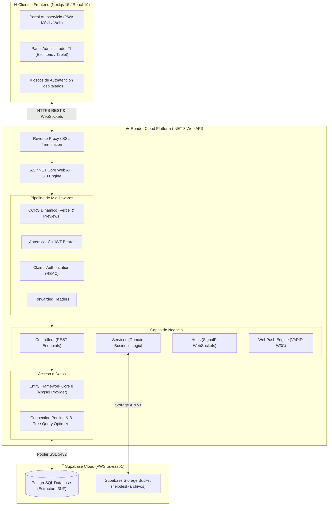
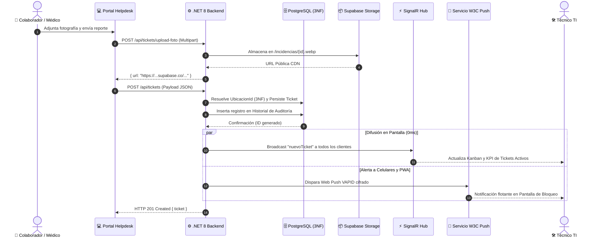
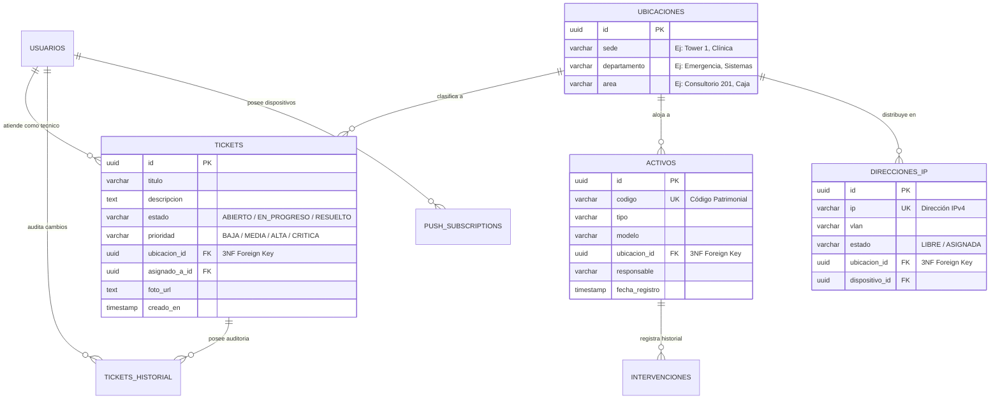

<div align="center">

# 🏥 IT Ops Backend & Mesa de Ayuda
### **Plataforma de Alto Rendimiento para Operaciones TI, Gestión de Activos, Redes y Gamificación**


<p align="center">
  <b>API RESTful empresarial y motor de mensajería bidireccional en tiempo real, diseñado con arquitectura limpia, normalización relacional en Tercera Forma Normal (3NF) y estándares de seguridad Zero-Trust.</b>
</p>

[Arquitectura](#-arquitectura-general-del-sistema) • [Estructura del Proyecto](#-estructura-detallada-de-carpetas) • [Normalización 3NF](#-modelo-de-datos-y-normalización-3nf) • [Tiempo Real & Web Push](#-tiempo-real--notificaciones-push) • [Variables de Entorno](#-variables-de-entorno-en-producción) • [Despliegue](#-despliegue-en-producción)

---

</div>

## 🏗️ Arquitectura General del Sistema

El backend actúa como el núcleo central de transacciones y distribución de eventos en tiempo real entre el portal público de autoservicio de incidencias, el panel administrativo de técnicos TI y los dispositivos móviles del personal.



---

## ⚡ Flujo de Vida de una Incidencia (Event-Driven Lifecycle)

Cuando un colaborador hospitalario o usuario reporta una falla técnica desde el portal, el sistema orquesta la persistencia, auditoría y distribución de alertas en paralelo:



---

## 📁 Estructura Detallada de Carpetas

El proyecto implementa una arquitectura modular desacoplada basada en el principio de **Responsabilidad Única (SRP)**:

```
it-ops-backend/
├── 📁 Controllers/         # Puntos de entrada HTTP (REST Endpoints)
├── 📁 Services/            # Lógica de negocio y reglas del dominio
│   └── 📁 Interfaces/      # Contratos de abstracción (Inyección de dependencias)
├── 📁 Models/              # Entidades del dominio mapeadas a PostgreSQL
├── 📁 DTOs/                # Objetos de transferencia de datos con validaciones
├── 📁 Data/                # Contexto de base de datos EF Core (ApplicationDbContext)
├── 📁 Hubs/                # Canales WebSockets de SignalR para eventos en vivo
├── 📁 Properties/          # Perfiles de inicio y configuración local
├── 📄 Dockerfile           # Compilación multi-etapa para producción Linux/Alpine
├── 📄 Program.cs           # Inicializador de servicios, middlewares y DI
├── 📄 appsettings.json     # Configuración local (excluido de Git por seguridad)
└── 📄 appsettings.Example.json # Plantilla con placeholders seguros
```

---

### 📂 1. `Controllers/` (Capa de Presentación REST)
Controladores que reciben las peticiones HTTP, validan los tokens JWT y delegan la ejecución a los servicios correspondientes:

| Controlador | Ruta Base | Responsabilidad Principal |
|---|---|---|
| [`AuthController.cs`](Controllers/AuthController.cs) | `/api/auth` | Login de usuarios, emisión de JWT y verificación de sesión (`/me`). |
| [`TicketsController.cs`](Controllers/TicketsController.cs) | `/api/tickets` | CRUD de incidencias, trazabilidad pública, auditoría, estadísticas y subida de evidencias. |
| [`ActivosController.cs`](Controllers/ActivosController.cs) | `/api/activos` | Inventario de hardware hospitalario, asignaciones e intervenciones técnicas. |
| [`UbicacionesController.cs`](Controllers/UbicacionesController.cs) | `/api/ubicaciones` | Gestión de sedes, departamentos y áreas en Tercera Forma Normal (3NF). |
| [`RedController.cs`](Controllers/RedController.cs) | `/api/red` | Monitoreo de switches/routers, simulación de caídas, asignación y liberación de IPs. |
| [`UsuariosController.cs`](Controllers/UsuariosController.cs) | `/api/usuarios` | Control de personal, roles (Admin/Técnico/Usuario) y permisos modulares. |
| [`GamificacionController.cs`](Controllers/GamificacionController.cs) | `/api/gamificacion` | Sistema de puntaje XP, medallas corporativas y ranking competitivo. |
| [`AcademiaController.cs`](Controllers/AcademiaController.cs) | `/api/academia` | Cursos técnicos, módulos interactivos, preguntas evaluativas y avance. |
| [`GuiasController.cs`](Controllers/GuiasController.cs) | `/api/guias` | Base de conocimiento, manuales técnicos y material descargable en PDF. |
| [`PushNotificationController.cs`](Controllers/PushNotificationController.cs) | `/api/notifications/push` | Registro, desuscripción y pruebas de notificaciones móviles Web Push (VAPID). |
| [`ConfiguracionController.cs`](Controllers/ConfiguracionController.cs) | `/api/configuracion` | Parámetros del sistema, PIN de autoservicio y catálogos maestros. |

---

### 📂 2. `Services/` (Capa de Lógica de Negocio)
Aísla las reglas de negocio del framework web. Todo servicio implementa su interfaz ubicada en `Services/Interfaces/`:

* **`TicketsService.cs`:** Automatiza el cálculo de SLAs, asigna puntos XP, normaliza las ubicaciones foráneas y emite las métricas analíticas multisede.
* **`PushNotificationService.cs`:** Orquesta el cifrado de payloads Web Push según la especificación RFC 8291/8292 usando la librería oficial `WebPush`.
* **`StorageService.cs`:** Cliente HTTP directo hacia Supabase Storage API para almacenar y eliminar imágenes y adjuntos en CDN pública.
* **`ActivosService.cs`:** Controla el ciclo de vida del equipamiento médico/tecnológico y registra intervenciones preventivas o correctivas.
* **`RedService.cs`:** Administra el pool de direccionamiento IPv4 por VLAN y audita caídas de nodos de red.
* **`AuthService.cs`:** Hasheo criptográfico con BCrypt y generación de claims estándar JWT (`id`, `email`, `role`, `exp`).

---

### 📂 3. `Models/` (Entidades del Dominio)
Modelos de Entity Framework Core mapeados contra tablas de PostgreSQL:

* **`Ticket.cs`:** Clave primaria `id` (UUID), estado (`ABIERTO`, `EN_PROGRESO`, `RESUELTO`), prioridad, clave foránea `ubicacion_id` y relación con `Usuario`.
* **`Activo.cs`:** Código patrimonial único, marca, modelo, número de serie, ubicación e historial de mantenimientos.
* **`Ubicacion.cs`:** Catálogo centralizado en 3NF con `Sede`, `Departamento` y `Area`.
* **`RedModels.cs`:** Entidades `DispositivoRed`, `DireccionIP` (mapeada a `ubicacion_id`) y `PushSubscription` (tokens de dispositivos móviles).
* **`Usuario.cs`:** Perfil técnico con XP acumulado, nivel, rol y lista de módulos con acceso concedido.

---

### 📂 4. `Hubs/` (Canal de WebSockets en Tiempo Real)
* **`NotificacionesHub.cs`:** Hub centralizado de **Microsoft SignalR** mapeado en `/ws/notificaciones`.
  * Multiplexa eventos en tiempo real hacia todos los navegadores conectados sin recargas ni saturación del servidor.
  * Eventos principales: `nuevoTicket`, `ticketActualizado`, `ticketEliminado`, `dispositivoActualizado`, `alertared`.

---

## 🗃️ Modelo de Datos y Normalización 3NF

Para garantizar rendimiento óptimo con miles de registros en producción y eliminar la redundancia de texto, las tablas operativas utilizan claves foráneas hacia el catálogo maestro de ubicaciones:



> [!TIP]
> **Índices de Alto Rendimiento:**
> La base de datos cuenta con índices B-Tree específicos en PostgreSQL (`idx_tickets_ubicacion_id`, `idx_tickets_estado`, `idx_tickets_creado_en`, `idx_activos_codigo`) para asegurar búsquedas sub-milisegundo.

---

## 📲 Tiempo Real & Notificaciones Push

El sistema maneja dos capas independientes y complementarias de notificación:

1. **Capa In-App (SignalR / WebSockets):**
   * Mientras la aplicación web está abierta en el navegador del técnico o recepcionista, SignalR mantiene un canal WebSockets continuo que refresca tableros, contadores y métricas en **0 milisegundos**.
2. **Capa Background (W3C Web Push / VAPID):**
   * Si el técnico tiene el celular bloqueado en el bolsillo o la pestaña cerrada, el backend despacha una notificación encriptada directamente a través de los servidores de Google Chrome / Mozilla / Apple, despertando la pantalla del dispositivo.

---

## ⚙️ Variables de Entorno en Producción

El backend extrae sus configuraciones directamente de las variables del sistema operativo o contenedor:

| Variable | Tipo | Descripción | Ejemplo |
|---|---|---|---|
| `ASPNETCORE_ENVIRONMENT` | Requerida | Entorno de ejecución de ASP.NET Core | `Production` |
| `PORT` | Opcional | Puerto HTTP dinámico asignado por Render/Cloud | `10000` |
| `DATABASE_URL` | Requerida | Cadena de conexión PostgreSQL (Npgsql o URL) | `Host=aws-0-us-east-1.pooler...;Password=...` |
| `JWT_SECRET` | Requerida | Firma criptográfica de tokens (mínimo 32 caracteres) | `mi_secreto_super_seguro_produccion_2026` |
| `SUPABASE_URL` | Requerida | Endpoint del proyecto Supabase | `https://xxxx.supabase.co` |
| `SUPABASE_SERVICE_KEY` | Requerida | Clave JWT `service_role` de Supabase | `eyJhbGciOiJIUzI1NiIsInR5cCI6IkpXVCJ...` |
| `SUPABASE_BUCKET` | Opcional | Nombre del bucket para imágenes | `helpdesk-archivos` |
| `ALLOWED_ORIGINS` | Opcional | Dominios frontend autorizados para CORS | `https://midominio.com,*.vercel.app` |
| `VAPID_PUBLIC_KEY` | Opcional | Clave pública VAPID para Web Push | `BEBWWjLDPLE1DJaY7MHN...` |
| `VAPID_PRIVATE_KEY` | Opcional | Clave privada VAPID para Web Push | `SQdZm13gJ8h_R4X6...` |
| `VAPID_SUBJECT` | Opcional | Contacto del emisor de notificaciones | `mailto:soporte@clinicalimatambo.com` |

---

## 🐳 Despliegue en Producción

### Despliegue Automatizado con Docker en Render
1. Conectar este repositorio en [Render](https://dashboard.render.com) como **Web Service**.
2. Seleccionar entorno de ejecución: **Docker**.
3. Render detectará automáticamente el archivo multi-etapa [`Dockerfile`](Dockerfile) y compilará la imagen en binarios optimizados de producción.
4. Cargar las variables de entorno en la sección **Environment** del panel de Render.

### Ejecución Local con .NET CLI
```bash
# 1. Restaurar dependencias de NuGet
dotnet restore

# 2. Compilar solución
dotnet build -c Release

# 3. Iniciar el servidor
dotnet run
```
La API estará escuchando en `https://localhost:7172` y `http://localhost:5155`.

### Endpoint de Monitoreo (Health Check)
```http
GET /health
```
**Respuesta:**
```json
{
  "status": "healthy",
  "framework": ".NET 8",
  "service": "IT Ops Backend",
  "timestamp": "2026-11-03T20:50:33.00961Z"
}
```

---

<div align="center">
  <b>Desarrollado con estándares de ingeniería de software corporativa para Limatambo Soporte TI.</b>
</div>
